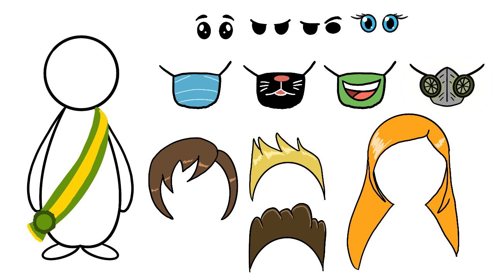

# 40 Days

A decision game about a city in quarantine. You are the mayor, and the quarantine lasts 40 days. Each choice that you make changes the economy, the health, the people, the politics, and the research of your city. The team made it in one week for the Stay Home Jam in 2020, with Unity.

[](https://jogos.opovo.com.br/40days/)
[](https://unity.com/releases/editor/archive)



To play, open https://jogos.opovo.com.br/40days/ in a browser with WebGL. The game text is in Portuguese.

## How to play

1. Make your mayor: choose the hair, the eyes, the mask, your name, and the name of your city.
2. On the city map, an exclamation point marks a place with an event. Click the place to open the event.
3. Each event has four answers. Each answer changes some of the five indicators: economy, health, population, politics, and research.
4. After five decisions, a new week starts. The quarantine has five weeks.

Each indicator goes from 0 to 100:

- If one indicator reaches 0, the city collapses, and you lose.
- If two indicators reach 100 together, you win. For example, research and economy at 100 mean that the city found a cure and can pay for it.
- If you reach the end of the quarantine and nothing collapsed, the game ends with no win and no loss.

The events happen in seven places: the bank, the community center, the hospital, the media center, the political chamber, the storage, and the university.

## Run the project

You need Unity 2019.2.17f1. A later 2019 version can work too.

1. Clone the repository.
2. In Unity Hub, click "Add", and select the folder of the repository.
3. Open the project. Unity makes the `Library` folder on the first start, so the first start takes some minutes.
4. Open `Assets/Scenes/Menu.unity`, and click Play.

To make a browser build, open File > Build Settings, select WebGL, and click Build. The project has a responsive WebGL template in `Assets/WebGLTemplates/Responsive`.

## Project structure

```text
Assets/
  Scenes/          # Menu, Character_creation, Game, Game Over, and Game Win, in the build order
  Script/          # All the C# scripts of the game
  Sprites/         # The art, the animations, the prefabs, and the sounds
  Fonts/           # The fonts of the game
  WebGLTemplates/  # The page around the WebGL build
Packages/          # The Unity packages of the project
ProjectSettings/   # The settings of the Unity project
docs/              # Images for this file
```

The main scripts are these:

| Script | What it does |
| --- | --- |
| `Game_Controller.cs` | The indicators, the weeks, the events on the map, and the end of the game. |
| `creation_controller.cs` | The screen where you make your mayor. |
| `Question.cs` | One event: the question, the four answers, and how each answer changes the indicators. |
| `database_*.cs` | The events of each place, such as `database_hospital.cs`. |
| `Bank.cs`, `Hospital.cs`, and the other place scripts | The events that each place can show in each week. |
| `canvas_*.cs` | The window that shows the event of a place. |

## History

The team made 40 Days in one week for the Stay Home Jam, a game jam during the COVID-19 quarantine of 2020. The team worked on another Git platform, and then copied the final version to this repository. In 2026, this repository got an English README, a `.gitignore` for Unity, and one folder for all the scripts. The game code did not change.
